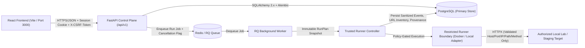
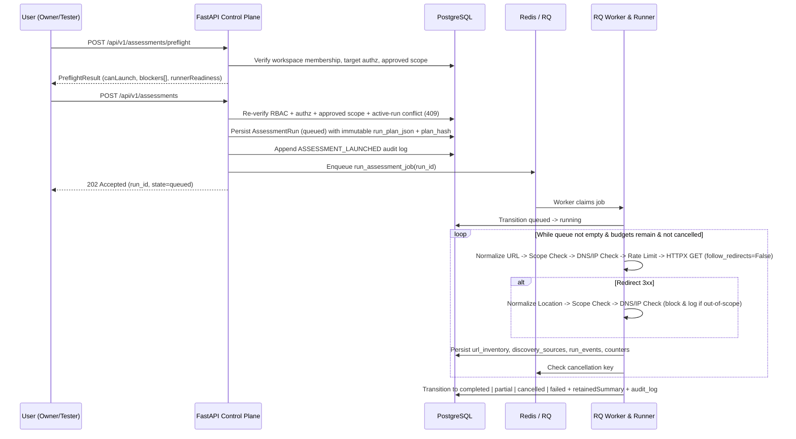
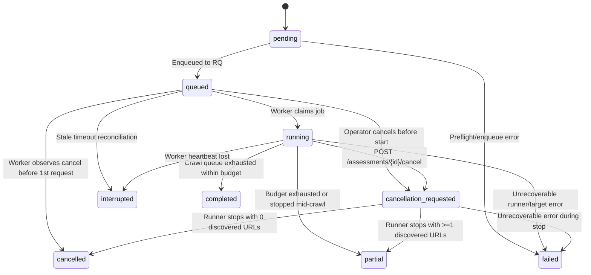

# Backend Architecture — Semester 7 (Control Plane, Queue, & Safe Runner)

## 1. High-Level Component Architecture

The Semester 7 backend enforces strict separation between the **authoritative control plane** (FastAPI), **durable persistence** (PostgreSQL), **asynchronous job coordination** (Redis + Python RQ), and **untrusted target interaction** (Trusted Runner Controller + Restricted Runner Boundary).

---

## 2. Responsibility Boundaries

| Layer | Responsibilities | Explicit Prohibitions |
| :--- | :--- | :--- |
| **React Frontend** | Presentation, form validation UX, polling run status | Never sends direct HTTP requests to target URLs; never holds authoritative RBAC/scope authority |
| **FastAPI Control Plane** | Auth/session validation, CSRF check, RBAC, project isolation, target authorization, scope versioning, preflight gating, immutable run-plan creation, inventory & audit APIs | Never runs crawls inside HTTP request handlers; never trusts client-supplied roles or scope decisions |
| **PostgreSQL** | Durable relational state for users, sessions, workspaces, projects, targets, authorization records, scope versions, runs, events, URL inventory, provenance, and append-only audit logs | Never stores plaintext passwords, raw target secrets, or raw session tokens |
| **Redis + Python RQ** | Asynchronous job queue, short-lived cancellation signal (`abm:run:cancel:{run_id}`) | Not the source of truth for run history or URL inventory (survives Redis restart via PostgreSQL) |
| **Trusted Runner Controller** | Reads immutable `RunPlan`, checks cancellation signal, invokes restricted runner boundary, persists `run_events`, `url_inventory`, `discovery_sources`, and updates run counters/state | Never trusts unvalidated crawler output; enforces output size and count caps |
| **Restricted Runner Boundary** | Executes HTTPX same-origin crawl under pre-request normalization, scope allowlist, DNS/IP validation, manual redirect revalidation, and depth/request/rate/concurrency/time budgets | No Docker daemon socket; no DB credentials; no control-plane secrets; non-root; read-only rootfs in container mode |

---

## 3. Core Workflows

### 3.1 Assessment Launch & Immutable Snapshot Flow

### 3.2 Run State Machine

---

## 4. Runner Isolation Model

1. **Docker Container Runner (`DockerRunnerExecutor`):**
   - Uses `backend/Dockerfile.runner` built as a dedicated unprivileged user (`runner`, UID 10001).
   - Launched with `--read-only`, `--cap-drop=ALL`, `--security-opt=no-new-privileges:true`, `--pids-limit=64`, `--memory=256m`, `--cpus=0.5`, `--tmpfs=/tmp:rw,noexec,nosuid,size=32m`.
   - Receives ONLY the serialized immutable `RunPlan` JSON on stdin and writes bounded JSON output to stdout.
   - Never mounts `/var/run/docker.sock`, `.env`, or PostgreSQL/Redis credentials.
2. **Restricted Local Runner Adapter (`LocalRestrictedRunnerExecutor`):**
   - Used when Docker daemon is unavailable in local academic development/CI environments (including the current Windows host without Docker).
   - Executes the exact same `crawler.py` policy/normalization/DNS/redirect/budget engine with zero database or control-plane access.
   - `/api/v1/runner/health` reports the active runner mode (`docker` vs `local_restricted`) truthfully.
