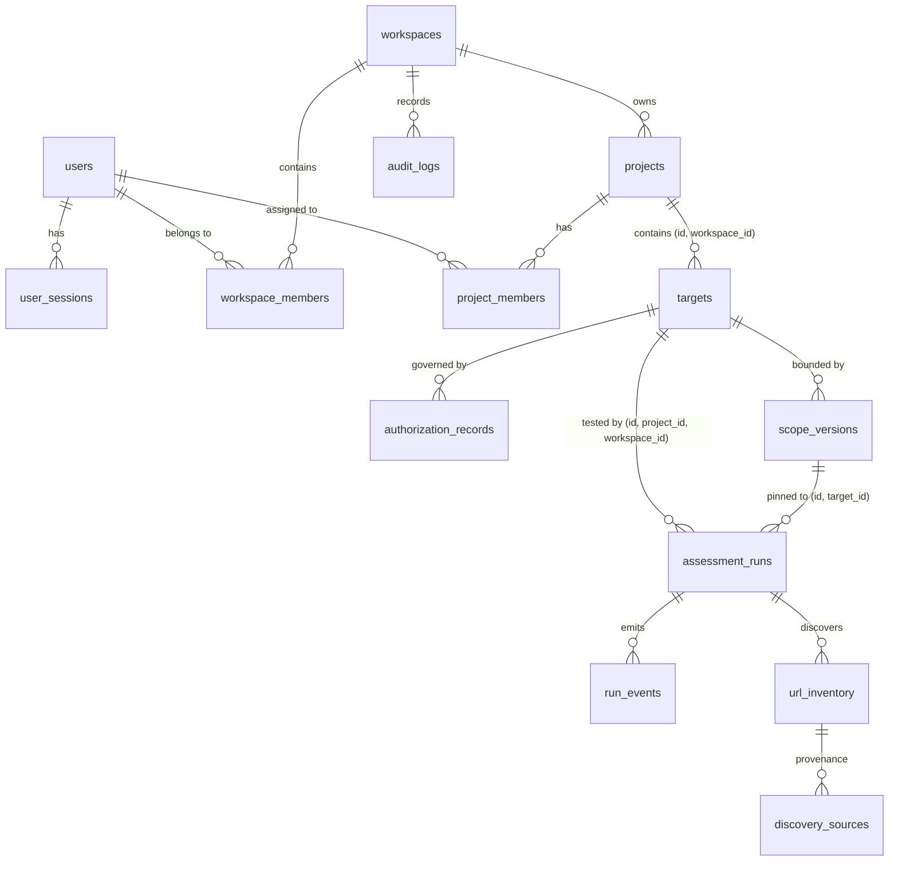

# Semester 7 Relationships & ERD (`DATABASE_RELATIONSHIPS_AND_ERD_S7.md`)

## 1. Semester 7 Entity-Relationship Diagram

## 2. Composite Ownership & Referential Integrity
1. **`projects` -> `targets`:** Composite FK `(project_id, workspace_id) REFERENCES projects(id, workspace_id) ON DELETE CASCADE` prevents a target from referencing a project in a different workspace.
2. **`targets` -> `assessment_runs`:** Composite FK `(target_id, project_id, workspace_id) REFERENCES targets(id, project_id, workspace_id) ON DELETE CASCADE` guarantees run ownership aligns with target/project/workspace.
3. **`scope_versions` -> `assessment_runs`:** Composite FK `(scope_version_id, target_id) REFERENCES scope_versions(id, target_id) ON DELETE RESTRICT` guarantees a run can only pin a scope version belonging to its own target and prevents deleting a scope version referenced by a run.

## 3. Delete / Update Behavior
- **`RESTRICT`:** `workspaces.owner_id`, `projects.owner_id`, `authorization_records.declaring_user_id`, `scope_versions.created_by_id`, `assessment_runs.initiated_by_id`, `assessment_runs(scope_version_id, target_id)` — prevents orphaning historical governance/execution attribution.
- **`SET NULL`:** `audit_logs` FKs (`workspace_id`, `project_id`, `target_id`, `actor_user_id`), `granted_by_id`, `reviewed_by_user_id`, `approved_by_id` — preserves audit & governance history even if an actor or project is later removed.
- **`CASCADE`:** `user_sessions` (user deleted), `workspace_members`, `project_members`, `authorization_records` (target deleted), `run_events` (run deleted), `discovery_sources` (inventory item deleted).

## 4. Deferred Semester 8 Entities (Not in S7 ERD)
Explicitly deferred to Semester 8: `openapi_contracts`, `api_operations`, `behavior_graph_nodes`, `behavior_graph_edges`, `test_identities`, `invariant_rules`, `zap_alerts`, `findings`, `evidence_packages`, `reports`, `benchmark_cases`, `ai_suggestions`.
