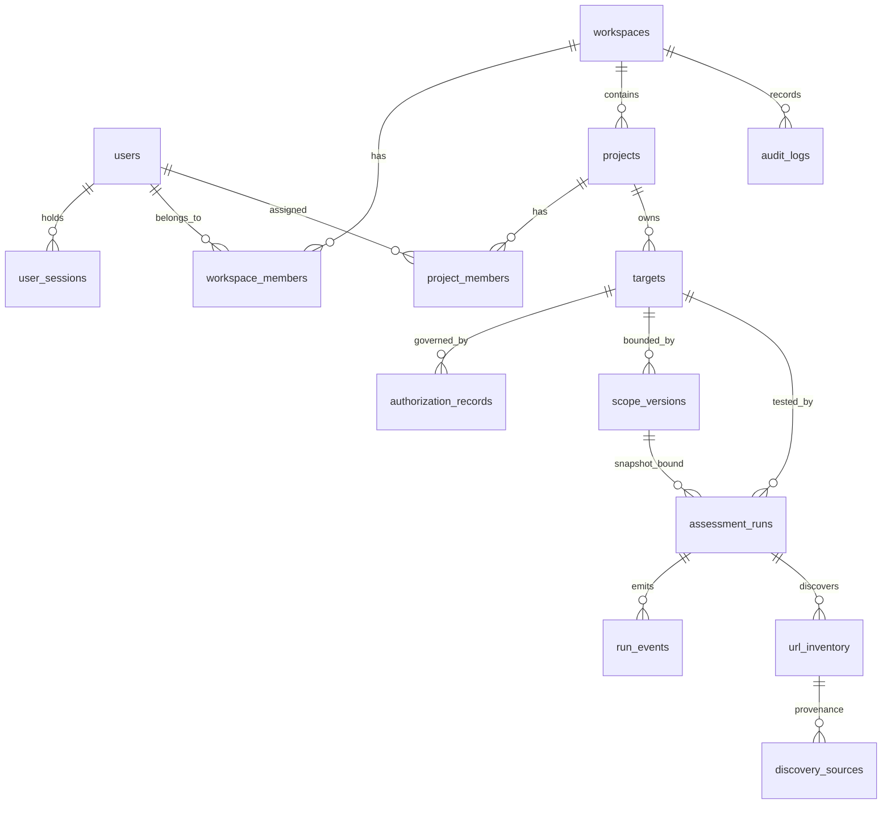

# Data Model — Semester 7 Entities Only

All timestamps are stored as timezone-aware UTC (`DateTime(timezone=True)`). Externally exposed resources use UUID primary keys and strict foreign-key constraints. **No Semester 8 entities** (OpenAPI contracts, operations, behavior graph nodes/edges, test identities, business invariants, findings, evidence, benchmarks, or reports) are created in Semester 7.

---

## 1. Entity-Relationship Diagram

---

## 2. Table Specifications (Semester 7 Baseline Migration `0001_semester7_baseline`)

1. **`users`**: `id` (UUID PK), `email` (unique lowercase), `username` (unique lowercase), `display_name`, `password_hash` (Argon2id), `global_role`, `account_status`, `department`, `failed_login_count`, `locked_until`, `last_login_at`, `created_at`, `updated_at`.
2. **`user_sessions`**: `id` (UUID PK), `user_id` (FK -> `users.id`), `token_hash` (unique SHA-256), `csrf_token_hash`, `expires_at`, `revoked_at`, `ip_address`, `user_agent_summary`, `created_at`, `last_seen_at`.
3. **`workspaces`**: `id` (UUID PK), `slug` (unique), `name`, `description`, `semester_label`, `owner_id`, `is_active`, `created_at`, `updated_at`.
4. **`workspace_members`**: `id`, `workspace_id` (FK), `user_id` (FK), `role`, `status`, `granted_by_id`, `granted_at`. Unique `(workspace_id, user_id)`.
5. **`projects`**: `id`, `workspace_id` (FK), `owner_id` (FK), `name`, `description`, `environment_context`, `status`, `deleted_at` (reserved nullable retention column), `created_at`, `updated_at`.
6. **`project_members`**: `id`, `project_id` (FK), `user_id` (FK), `role`, `status`, `added_by_id`, `added_at`. Unique `(project_id, user_id)`.
7. **`targets`**: `id`, `workspace_id`, `project_id`, `display_name`, `description`, `base_url`, `normalized_base_url`, `scheme`, `hostname`, `port`, `base_path`, `environment`, `authorization_status`, `ownership_declaration`, `permission_reference`, `current_scope_version_id`, `last_authorization_review_at`, `created_at`, `updated_at`.
8. **`authorization_records`**: `id`, `target_id` (FK), `declaring_user_id`, `reviewed_by_user_id`, `permission_reference`, `ownership_declaration`, `declaration_hash` (SHA-256), `state`, `scope_version_label`, `notes`, `effective_at`, `expires_at`, `revoked_at`, `created_at`.
9. **`scope_versions`**: `id`, `target_id` (FK), `version_number`, `version_label`, `approval_state`, `allowed_hosts`, `allowed_ports`, `allowed_path_prefixes`, `excluded_paths`, `allowed_methods`, `follow_redirects_in_scope_only`, `state_changing_methods_enabled`, `block_private_and_link_local`, `local_lab_exception_active`, `budgets`, `normalized_preview`, `policy_hash`, `change_summary`, `created_by_id`, `approved_by_id`, `created_at`, `approved_at`. Unique `(target_id, version_number)`.
10. **`assessment_runs`**: `id`, `run_code` (unique), `workspace_id`, `project_id`, `target_id`, `scope_version_id`, `initiated_by_id`, `rq_job_id`, `modules`, `run_plan_json` (immutable snapshot), `plan_hash`, `state`, `current_phase`, `phases_json`, `progress_percent`, `request_count`, `request_budget`, `discovered_urls_count`, `in_scope_urls_count`, `excluded_urls_count`, `duplicate_urls_count`, `blocked_redirects_count`, `retained_summary`, `started_at`, `heartbeat_at`, `completed_at`, `duration_seconds`, `created_at`.
11. **`run_events`**: `id`, `run_id` (FK), `event_type`, `level`, `phase`, `message`, `detail_json`, `correlation_id`, `created_at`.
12. **`url_inventory`**: `id`, `workspace_id`, `project_id`, `target_id`, `run_id` (FK), `canonical_key`, `normalized_url`, `scheme`, `host`, `port`, `path`, `method_hint`, `asset_type`, `primary_source`, `scope_status`, `scope_reason`, `test_status`, `parameter_names`, `form_metadata`, `status_code`, `content_type`, `depth`, `hit_count`, `first_seen_at`, `last_seen_at`. Unique `(run_id, canonical_key)`.
13. **`discovery_sources`**: `id`, `url_inventory_id` (FK), `run_id` (FK), `source_type`, `referring_url`, `element_context`, `observed_at`.
14. **`audit_logs`**: `id`, `workspace_id`, `project_id`, `target_id`, `actor_user_id`, `actor_email`, `actor_role`, `action`, `resource_type`, `resource_id`, `outcome`, `correlation_id`, `correlation_run_id`, `detail`, `metadata_json`, `integrity_hash`, `created_at`.
